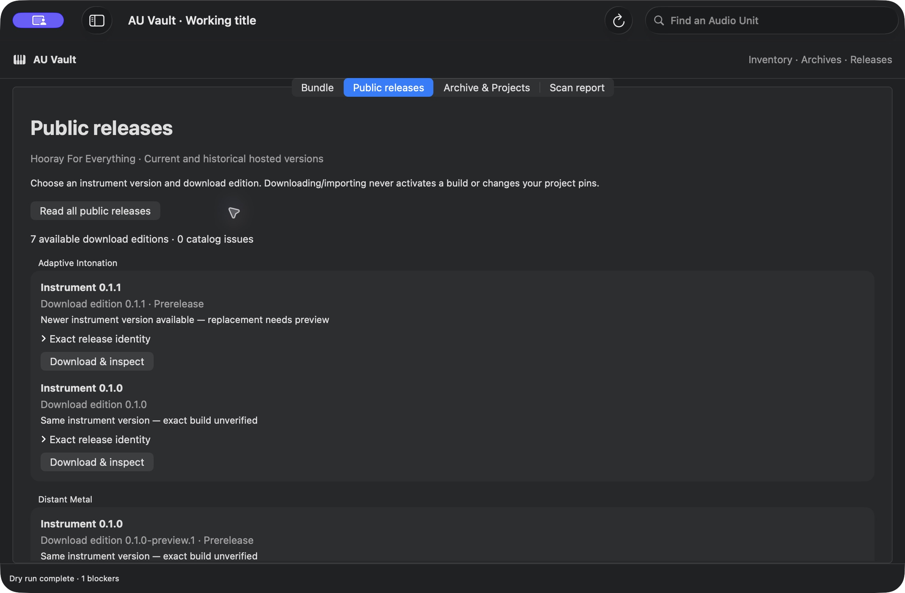
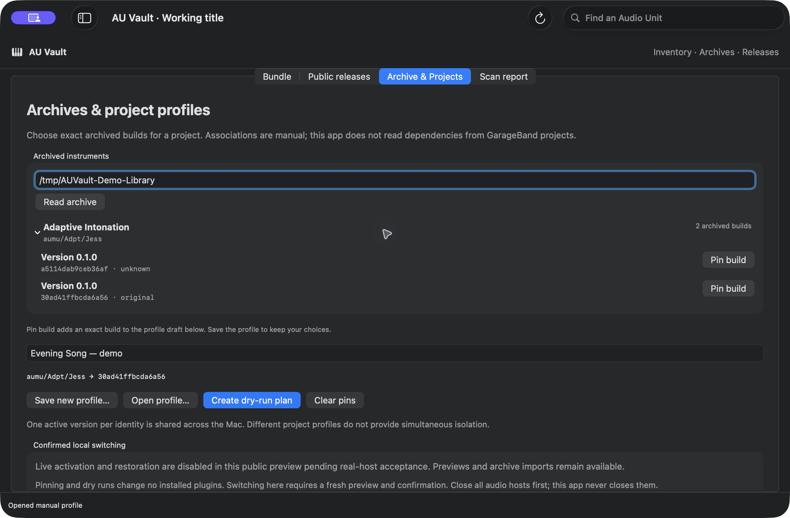
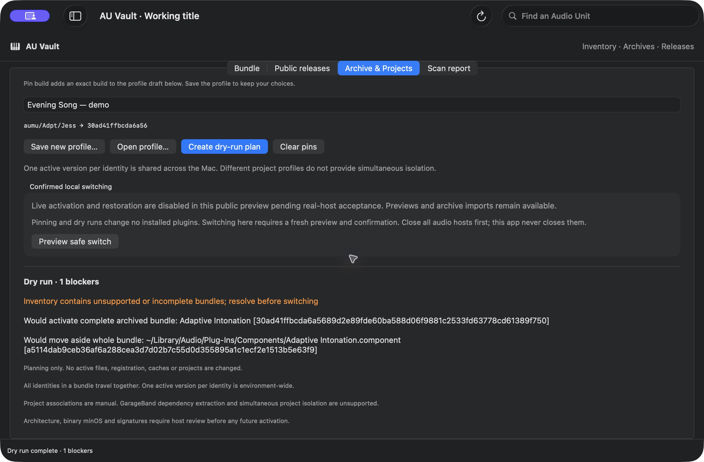
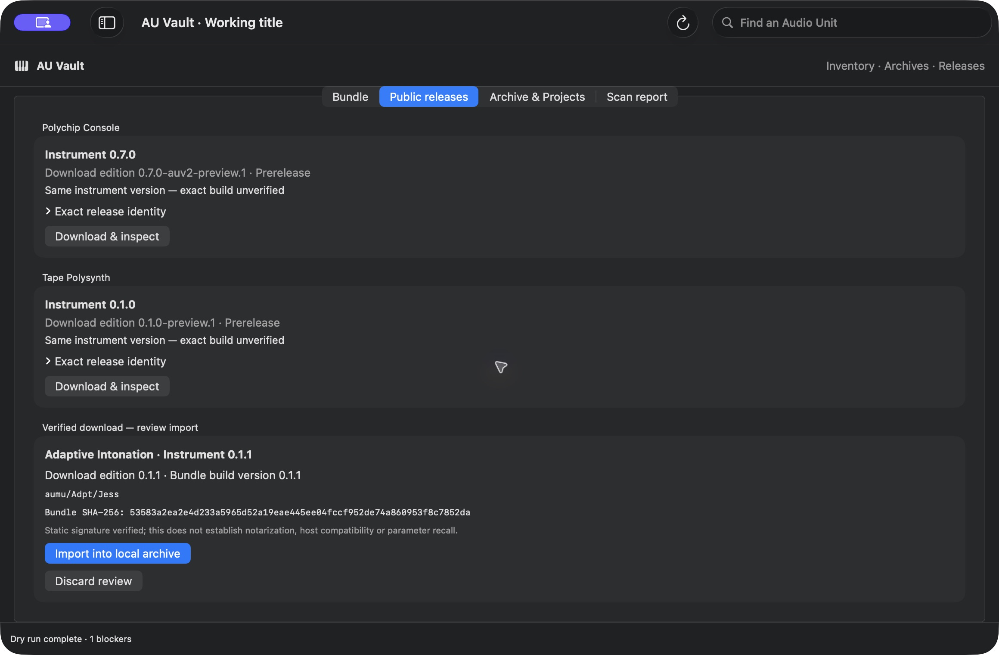

# AU Vault — a picture tour

These are real Preview 1 screens. The song name and temporary library are demonstration examples, not a saved GarageBand song. No installed instrument was switched.

## Find an update or a historical version

Open **Public releases** and choose **Read all public releases**. Pick the edition you need; current and older hosted versions appear together.

## Choose builds for a song

In **Archive & Projects**, expand an instrument and choose **Pin build**. Give the profile your song's name and choose **Save new profile…**. **Open profile…** brings those choices back. A profile is your chosen list, not an automatic scan of a song file.

Two builds can report the same version number. This example keeps both and selects one exact build.

## Preview what a song would need

Choose **Create dry-run plan**. Read the proposed differences and any issues. Nothing is changed: live switching is disabled in this preview.

## Review a download before adding it

**Download & inspect** checks the published package first. Choose **Import into local archive** to add it to your library. Importing does not install it in GarageBand or change a song profile.

See [the quick guide](START-HERE.md) for the complete steps and Mac requirements.
